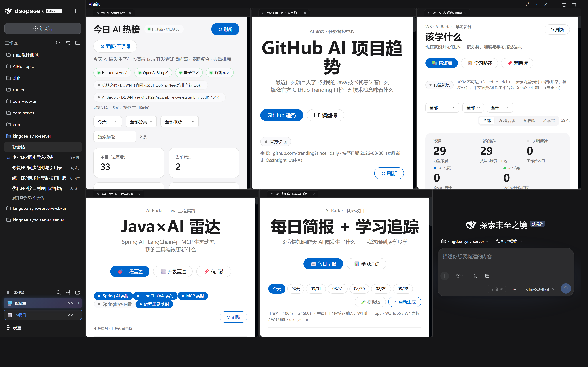
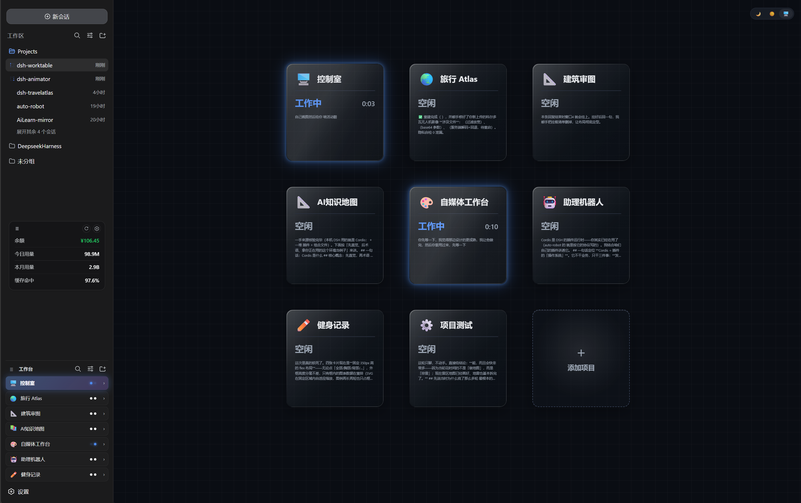
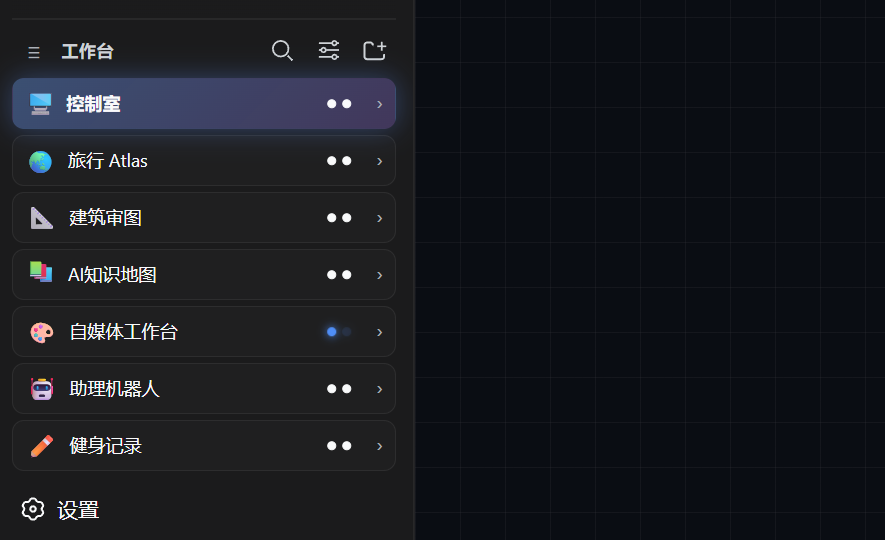
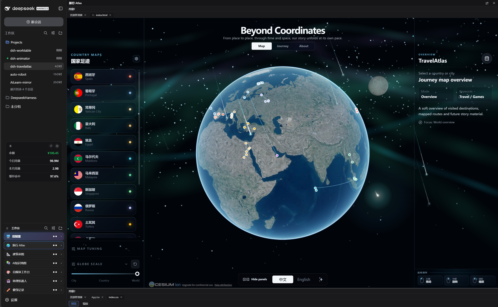

# dsh-worktable 🖥️

<p align="center"><a href="README.md"><b>English</b></a> · 简体中文</p>

**DeepSeek Harness 的 agent 项目工作台**——侧边栏「应用抽屉」把每个项目变成可停靠的窗口，再加一个实时监控所有项目的内置「控制室」。

## 📸 截图

| | |
|---|---|
|  | **📰 AI资讯项目控制台** —— 顶行三窗 + 主行两窗同屏挂载窗口任务产物（AI 热榜 / GitHub AI 项目趋势 / 学习资源 / Java×AI 雷达 / 每日简报），右侧对话窗常驻 |
|  | **🖥️ 控制室主界面** —— 内置默认项目：实时卡片网格监控每个项目（工作中 / 待你决定 / 已完成），蓝图网格上的玻璃拟态卡片 |
|  | **🧩 工作台侧边栏** —— 应用抽屉：项目、快捷方式与固定首位的控制室入口 |
|  | **🪟 我们的项目** —— 每个项目打开为可停靠的分栏工作区（含旅行 Atlas 等入驻应用） |

---

## ✨ 功能导览

### 🧩 侧边栏应用抽屉

- 收纳你的自建项目（以及 dsh-travelatlas 等入驻插件项目）
- 项目支持改名 / 图标 / 排序 / 隐藏；每个项目有专属文件夹；**项目 ↔ 对话多绑定**——打开项目自动切到主绑定（★）对话，≥2 个绑定时分栏标题栏出现会话切换器；任一绑定会话待决 / 完成 / 运行中，项目卡双圆点分别亮黄 / 亮绿 / 亮蓝
- 收起侧边栏后，每个项目变成可点击的方形小贴片（只留 emoji）

### 🪟 可停靠的分栏工作区

- 声明式布局预设（左栏 / 顶行 / 主网格 + 右侧对话窗）
- 可拖拽分割线、窗格标签页、按布局持久化的宽度记忆；**窗格可最小化**成窄条占位（让出宽度给同行，点击还原），空行自动折叠
- 内置窗格：**文件资源管理器、终端、浏览器、动画站点、自定义窗口、预置资源**
- 浏览器 / 动画窗格：前进 / 后退历史、地址栏与页面内导航双向同步（iframe 内跳转实时回报）、`_blank` / `window.open` 拦截为窗内导航；外部站点与本地服务经**整源反向代理**嵌入（剥掉 X-Frame-Options / CSP 限制）
- 自定义窗口：把需求发给新建或已有对话，agent 完成后产物自动挂载进对应窗口（锁死）

### 📌 预置资源

- 把常用的**浏览器链接**（网址 / 账号 / 密码 / 备注）和**本地资源**（文件或目录路径 / 备注）收进固定窗格，一键打开
- 每条目两种打开方式：**工作台分栏**（窗内嵌浏览器，本地文件走窗内文件预览）或**外部打开**（系统默认应用，附复制账号 / 复制密码按钮）
- 分栏打开登录页时自动填入暂存的账号密码——**只填入，不提交**；暂存 90 秒过期，填充完成后立即清除
- 文件路径以窗内文件预览打开；目录路径在文件资源管理器中定位到该目录
- 本地资源路径输入框（📂）支持弹窗浏览选择：内置盘符快捷切换（C / D / E…）、面包屑导航、目录与文件混合列表——目录行进入、文件行直接选中；也可以直接手填/粘贴路径文本；弹窗置顶显示，不被窗格遮挡

### 🖥️ 控制室（内置默认项目）

- 固定在首位的不可删除项目——首次打开绑定一条管理对话即可
- 三列卡片网格实时镜像**每一个**项目的状态：工作中 / 待你决定 / 已完成，附带运行时长与清洗后的最近消息预览
- 宿主会话快照的事件订阅镜像——**零轮询、零 Token**
- 玻璃拟态卡片、深色/白色/跟随系统主题、霓虹状态光效与工作中卡片的旋转彗星光点

---

## 一览

| | |
|---|------|
| 🧩 插件类型 | Cordis 插件——服务端路由 + Web 客户端，纯增量（不替换任何官方插件） |
| 🪟 工作区引擎 | 自研分栏引擎，渲染进宿主的 shell overlay 座位 |
| 💬 对话窗 | 复用宿主对话——插件只做会话选择（sessions.open） |
| 📡 状态数据 | 宿主会话运行时快照的镜像（订阅驱动） |
| 💾 状态存储 | 仅 localStorage（dsh.worktable.*），不碰工作区文件 |
| 🎨 界面 | TypeScript + React（宿主 external）+ 原生 CSS，暗色优先 + 浅色主题 |

---

## 快速开始

1. **安装**（二选一）：

   **A · 一行命令（推荐）** —— 直接安装 GitHub Release 的安装包，无需 Git：

   ```bash
   dsh plugin --profile web add "https://github.com/wrw-dev/dsh-worktable/releases/latest/download/dsh-worktable.tgz"
   ```

   **B · 本地克隆（想改源码用）** —— `link:` 只接受本地绝对路径（路径不要带空格）：

   ```bash
   git clone https://github.com/wrw-dev/dsh-worktable.git
   dsh plugin --profile web add "link:<克隆出来的 dsh-worktable 仓库目录的绝对路径>/01_content"
   # 例：克隆到 D:\tools 后 → dsh plugin --profile web add "link:D:/tools/dsh-worktable/01_content"
   ```

   两种方式 `add` 都会把 `dsh-worktable` 注册进 profile 的 bundle 列表（写入 `~/.dsh`，可能需要授权确认）；若提示找不到 `dsh` 命令，用 `npx @deepseek-ai/dsh` 代替。
2. **重启** DSH web 进程并刷新界面
3. **打开控制室**：点击固定首位的 🖥️ 控制室卡片 → 绑定一条对话（加入现有或新建）→ 得到实时卡片网格
4. **创建项目**：侧边栏 ＋ → 选布局预设、填项目文件夹

---

## 架构

一个包同时包含**宿主 Cordis 插件**与 **Web 客户端**：

- **宿主**：`/api/worktable/*` 路由——健康检查、文件系统（文件与目录）、git、文件读写、站点托管、mkdir、工作区、原生皮肤模板、整源反向代理（浏览器窗嵌外部站点）；WebSocket `/api/worktable/term` 提供终端窗格（Windows 下为 PowerShell）
- **客户端**：经 slot 协议注入侧边栏与 shell overlay；分栏引擎、标签模型、拖拽与持久化均为自研
- **控制室**：读取宿主会话列表快照（运行中/待决/已完成、后台任务、子代理目录）——事件驱动镜像，模型不参与
- **窗口任务**：agent 完成后在项目文件夹写 `widget-result.json`，客户端把产物挂载进指定窗口并锁死

---

## 开发与测试

```bash
cd 01_content
npm install
npm run build     # lib/index.js + lib/client.js
node --check lib/index.js
```

- **构建必须在 01_content 内执行**——在仓库根构建会把 lib 写到错误位置，宿主仍加载旧 bundle
- 客户端 bundle 保持 `window.__ModuleLoader__.load` 握手；react 与 @deepseek-ai/* 全部 external
- 回归：`04_test/functional-diag.cjs`（20 步）+ 专项探测（控制室、绑定弹窗、收起态贴片、模型继承）
- 项目控制台截图：`node 04_test/probe-project-shot.cjs <spec.json> <out.png>`——无头 Chrome 播种指定项目（多窗挂站点产物）并截真实界面（spec 见脚本头部说明；本仓库 README 的 AI资讯截图即出自它）

---

## 常见问题

**Q：DeepSeek Harness 更新后，工作台打不开 / 服务启动失败？**

先放心：你的数据不会丢 —— 项目、绑定、布局都存在浏览器本地（localStorage），项目文件都在你自己的项目文件夹里，升级或修复都不会动它们。按下面两种情况处理：

**情况 A：Harness 正常，只是工作台需要更新**

- 打开工作台「设置」→ 点「立即检查」；侧栏「工作台」旁出现琥珀色更新徽标时，点它选择「复制 AI 提示词」，把那段话发给你的 AI 助手执行即可；
- 或直接重跑安装命令（永远装最新版），装完重启 dsh web 并刷新：

  ```bash
  dsh plugin --profile web add "https://github.com/wrw-dev/dsh-worktable/releases/latest/download/dsh-worktable.tgz"
  ```

**情况 B：Harness 本身挂了**（服务起不来 / 报 Failed to load plugins）

- 首选：升级 Harness 到最新版（已知问题的官方修复通常都在新版里）：终端执行 `npx @deepseek-ai/dsh web`；
- 如果升级后仍然失败：把下面这段复制发给**任意 AI 助手**（Claude、Codex、GLM 等都可以，不需要 DeepSeek Harness 本身）：

> 帮我修复 DeepSeek Harness 的自研插件加载问题（报错通常是 Failed to load plugins 或服务启动失败）：
> 1. 终端执行 npx @deepseek-ai/dsh web 升级到最新版并启动；成功即结束。
> 2. 若仍失败：打开 ~/.dsh/profiles/web/package.json，找出 dependencies 里所有 link: 开头的插件路径，计算它们的共同上级目录（例如都装在 D:\projects 下，上级就是 D:\projects）。
> 3. 在该上级目录创建名为 node_modules 的目录联接，指向 ~/.dsh/profiles/node_modules：mklink /J "<上级目录>\node_modules" "%USERPROFILE%\.dsh\profiles\node_modules"；若该上级目录已存在 node_modules，就改用它的上一级目录再试。
> 4. 重启 dsh web，打开 http://127.0.0.1:3080 确认工作台恢复。

该问题已反馈 DeepSeek Harness 官方，正在修复；官方修复发布后，升级到新版即可彻底解决。

## 已知限制

- **平台**：Windows 是当前完整验证平台。macOS 为实验性支持：核心文件路径代码已做跨平台适配，但尚未在 macOS 真机完成端到端验证。
- 状态在浏览器本地（localStorage）——项目、绑定与视图不跨设备同步
- 终端窗格在 Windows 上是朴素的 PowerShell 宿主（与原生终端应用无 PTY 对等）
- 自动挂载要求 agent 确实在项目文件夹写出 `widget-result.json`
- 控制室只监控**已绑定对话**的项目；未绑定的项目显示为空闲

---

## 隐私

无遥测；除宿主 API 与插件自身路由外无任何网络请求。用户状态全部留在 localStorage。可选更新检查：对 GitHub Releases API 做只读 GET（自动每天最多一次，另有手动「立即检查」），不上传任何数据，可在设置中关闭。预置资源的账号密码经混淆后存于 localStorage；用于分栏自动填充的账号密码只在插件内存暂存 90 秒，填充完成后立即清除，不落盘。

---

## License

MIT

## 相关项目

- [dsh-reminder](https://github.com/Aisland-SJL/dsh-reminder) — 跨窗口的任务完成与审批提醒
- [dsh-usage](https://github.com/Aisland-SJL/dsh-usage) — 常驻的余额/用量面板
